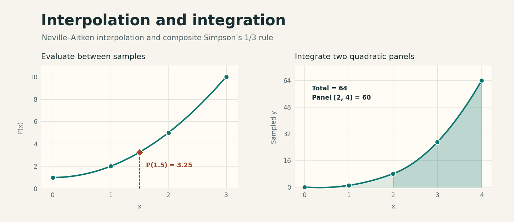
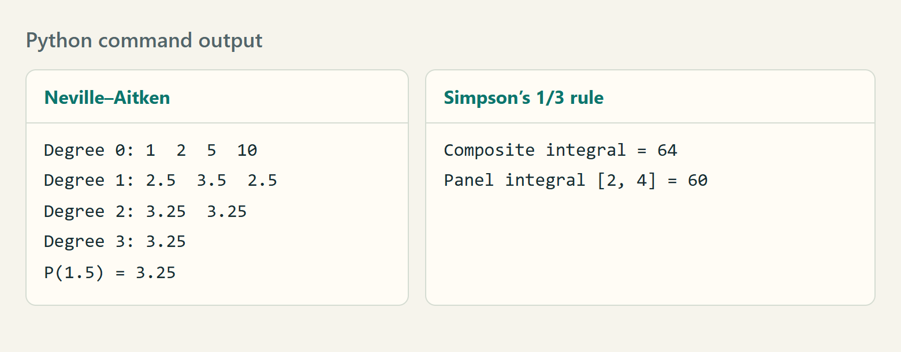

# Scientific Computation II

Two numerical methods for sampled data in pure Python. Use Neville–Aitken interpolation to estimate a value between samples, or Simpson’s 1/3 rule to estimate an integral from evenly spaced samples.

[Quick start](#quick-start) · [Interpolation](#nevilleaitken-interpolation) · [Integration](#simpsons-13-rule) · [Tests](#tests)



## Quick start

Run with Python 3.11. Both scripts and the tests use the standard library.

```bash
git clone https://github.com/HosnaSltn/scientific-computation-2.git
cd scientific-computation-2
python -m unittest -v
```

| File | What it does | Input requirements |
| --- | --- | --- |
| [neville_aitken.py](neville_aitken.py) | Evaluates an interpolating polynomial and can display the intermediate estimates | Paired values at distinct nodes |
| [simpson_rule.py](simpson_rule.py) | Integrates a full sample grid and optionally evaluates one three-point panel | Equally spaced nodes and an even number of intervals |

## Neville–Aitken interpolation

The four samples lie on $y = x^2 + 1$. Evaluate the interpolant at $x = 1.5$. The optional `--show-table` prints successive rows of intermediate estimates by polynomial degree.

```bash
python neville_aitken.py --x 0 1 2 3 --y 1 2 5 10 --at 1.5 --show-table
```

## Simpson's 1/3 rule

The five samples come from $y = x^3$. Composite Simpson’s rule covers $[0,4]$. `--panel 2` selects three adjacent samples starting at zero-based index 2 and integrates over $[2,4]$.

```bash
python simpson_rule.py --x 0 1 2 3 4 --y 0 1 8 27 64 --panel 2
```

<p align="center">
  
</p>

The same routines can be imported with `from neville_aitken import neville_aitken, neville_table` and `from simpson_rule import composite_simpson, simpson_panel`.

## Tests

Run `python -m unittest -v` from the repository directory. Tests cover exact polynomial examples, descending integration grids, invalid sample spacing, duplicate nodes, and panel bounds.
